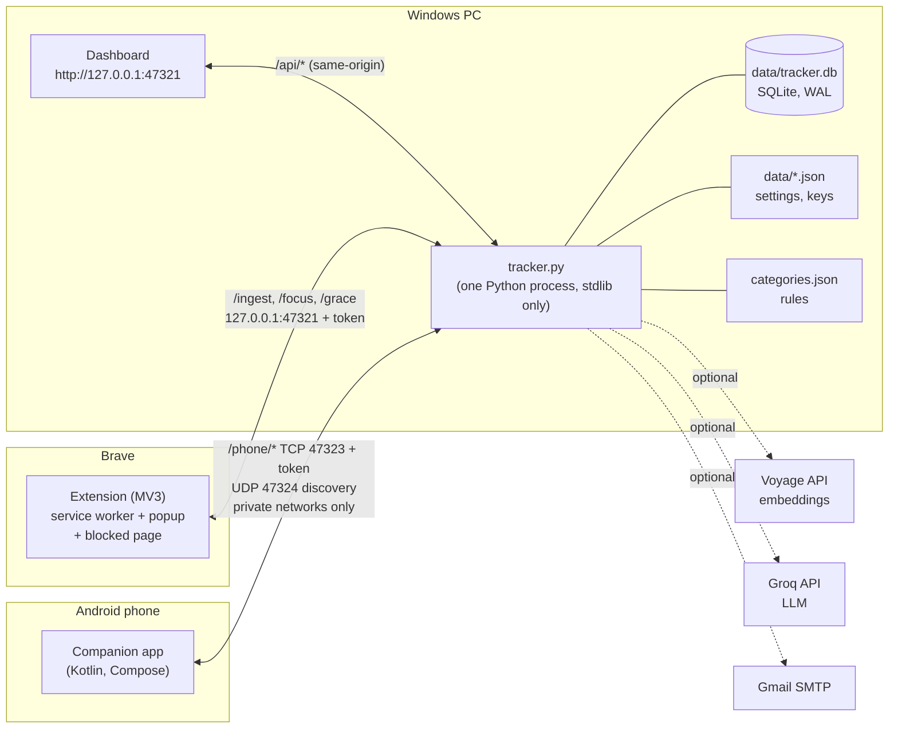
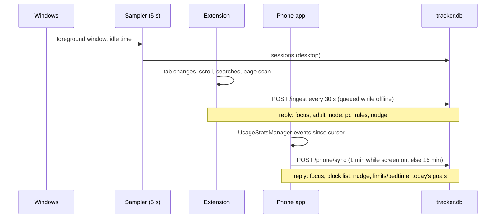
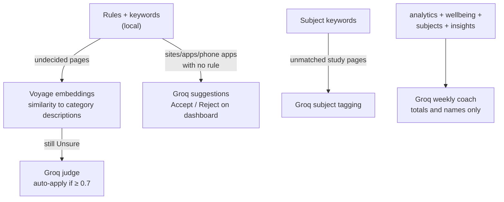

# Architecture

How Good ol Tracker fits together: the three clients, the one process that owns the
data, how data flows in and how rules flow back out. For *why* it's built this way, see
[decisions.md](decisions.md).

## 1. Overview



Principles that shape everything below:

- **One owner of the data.** Only the desktop process writes the database. The extension
  and the phone are clients: they send observations in, and get state back (focus,
  blocks, limits, alerts) in the replies.
- **Raw facts are stored, meaning is computed.** Sessions are stored without categories.
  Categories, focus streaks, goals, subjects and sleep are all worked out when data is
  read, so changing a rule changes all history at once.
- **Local first.** Everything works with no keys and no internet. AI and email are optional
  layers that fail soft.
- **No dependencies on the PC.** Python standard library only, plain HTML/CSS/JS for the
  dashboard, no build step.

## 2. The desktop process (`desktop/tracker.py`)

One process, started by the scheduled task **Good ol Tracker** (at login, plus a 5-minute
watchdog trigger). A lock makes extra launches exit at once.

| Thread | Cadence | Does |
|---|---|---|
| **Sampler** (main) | every 5 s | Foreground window + idle time (`win32.py`, ctypes). Extends the current `sessions` row or starts a new one. Idle ≥ 120 s closes it (unless the browser reports media playing). Hourly: purge page text older than 60 days. |
| **Dashboard/extension server** | on request | `ThreadingHTTPServer` on `127.0.0.1:47321` (`server.py`): dashboard files, `/api/*`, `/ingest`, `/focus`, `/grace`, `/nudge`, `/health`. |
| **Phone server** | on request | `ThreadingHTTPServer` on `0.0.0.0:47323` (`phone.py`), `/phone/*` only, private client addresses only. |
| **Discovery** | on request | UDP `0.0.0.0:47324`: answers "where is the tracker?" from the phone. |
| **Nudge worker** | every 30 s | Starts scheduled focus (`wellbeing.py`), checks for distraction streaks (`nudge.py`), hands an uncollected alert to the PC or Windows. |
| **Background worker** | every 120 s | Daily backup (`backup.py`), Voyage categoriser (`ai_categorize.py`), Groq judge (`ai_judge.py`), subject tagging (`subjects.py`), Monday weekly summary (`weekly.py`), email schedule (`mailer.py`). |

Each thread opens its own SQLite connection. WAL mode lets readers and the writer work at
the same time.

## 3. Data model

### SQLite (`data/tracker.db`, schema in `db.py`)

| Table | Holds | Written by |
|---|---|---|
| `sessions` | One row per continuous stretch. `source` = `desktop` (exe + window title: the time total), `browser` (site + tab title + URL + scroll %, from the extension), `phone` (Android package + app name). `client_id` makes re-sends idempotent. | sampler, `/ingest`, `/phone/sync` |
| `pages` | Scanned page content (title, author/channel, description, headings, body), one row per canonical URL | `/ingest` |
| `pages_fts` | FTS5 index over `pages`, kept in sync by triggers | triggers |
| `searches` | Every search: time, engine, site, query, URL | `/ingest` |
| `manual_entries` | Offline time you logged | dashboard |
| `page_ai`, `query_ai`, `prototype_vectors` | Voyage embeddings + the category they're closest to | Voyage step |
| `page_judge`, `name_judge` | Groq's category for *Unsure* pages; suggestions for unruled sites/apps | Groq judge |
| `subject_judge` | Groq's subject for study pages the keywords missed | subjects step |
| `focus_sessions`, `focus_blocks` | Focus sessions and every blocked attempt (sites and phone apps) | focus API, `/ingest`, `/phone/sync` |
| `phone_unlocks` | Phone unlock times | `/phone/sync` |
| `summaries` | Weekly/periodic AI summaries + the exact payload sent | `weekly.py` |
| `meta` | Small key/values: extension last seen, migration flags | various |

### Files

| File | Holds |
|---|---|
| `categories.json` | Categories, productive list, rules (`apps`, `sites`, `channels`, `pages`, `phone_apps`), keywords, AI descriptions |
| `data/token.txt` | Extension token |
| `data/*_key.txt` | Voyage, Groq, Gmail secrets |
| `data/focus.json` | Focus length, blocked sites, adult filter mode |
| `data/nudge.json` | Distraction alert settings |
| `data/wellbeing.json`, `wellbeing_grace.json` | Limits, bedtime, schedules, goals; "5 more minutes" used |
| `data/subjects.json` | Subjects, keywords, exams, weekly targets |
| `data/email.json` | Email schedule |
| `data/phone_devices.json` | Paired phones and their tokens |
| `data/rules_history.json` | Dashboard rule edits (for undo) |
| `data/backups/` | Daily zipped DB copies (14 kept) |

## 4. Data in



- **Browser time is a breakdown, not extra time.** When `brave.exe` is in front, its
  desktop time is split across the sites the extension saw at that moment. Without
  extension data, it falls back to the window title.
- **Phone time replaces overlapping PC time.** When both overlap, the PC was idle or
  unattended, so that second counts once, as phone time (`categorize._minus`).
- **The phone re-reads, it doesn't stream.** Android keeps about a week of usage events.
  The app keeps a *cursor*: the start of the last session the PC confirmed. Each sync
  rebuilds sessions from there. The session still running gets the same `client_id` and is
  extended with an upsert. Nothing is lost while the PC is off.

## 5. Read path: categorisation and analytics

Everything the dashboard, emails, phone and AI coach show comes from one function:

```
categorize.categorise(conn, start, end, rules) -> [Item(start, end, category, app, title, source, matched, url, via)]
```

1. **Load** desktop, browser and phone sessions plus manual entries for the range.
2. **Classify** each piece (first match wins): page rule → app/site/phone-app rule → adult
   site → channel rule → keywords → Voyage category → Groq judge → fallback. `via` records
   which step decided, e.g. for the dashboard's **AI** badge.
3. **Split** browser-in-front desktop time by the extension's visits.
4. **Remove overlaps:** subtract phone spans from PC items, and only count manual time
   where the PC was unused.

Built on top of it:

| Module | Computes |
|---|---|
| `analytics.py` | Dashboard summary: totals, per day/hour, focus streaks, switches, timeline, top apps/pages, topics, searches, unmatched/unsure lists, trends |
| `wellbeing.py` | Goals (per day, streaks), limit usage (phone app + its site, study time excluded), bedtime state, scheduled focus, the PC's `pc_rules` |
| `subjects.py` | Productive items tagged with subjects (keywords, then the Groq cache); per-subject totals, weekly targets, exam countdowns |
| `insights.py` | Sleep (longest quiet stretch at night), phone pickups between study stretches |
| `focus.py` | Focus sessions and their on-task score, block lists |
| `find.py` | Search what you've read: FTS5 + Voyage similarity, merged with reciprocal rank fusion |

Because nothing is cached in the database, a rule edit, new keywords or a new subject take
effect on the next read, for all history.

## 6. AI pipeline (optional)

Runs in the background worker. Each step only sees what the previous ones couldn't decide,
and each item is sent once and cached.



- **Filtering first:** `sitelists.py` reads the extension's `blocklist.js` and `adult.js`, so
  never-read and adult sites are filtered out before anything is sent.
- **Rate limits:** a rate limit or error pauses Groq calls for 10 minutes. At most 3 judge
  requests run every 2 minutes.
- **Re-asking:** caches are keyed by a hash of what was sent and of the category/subject list.
  Changing either asks again; nothing else does.

## 7. Rules out: enforcement

The desktop process decides; the clients enforce.

| Rule | Decided in | Browser (extension) | Phone (app) |
|---|---|---|---|
| Focus session | `focus.py` (`focus_sessions`) | DNR redirect rules for the block list + tab check fallback | Accessibility service sends blocked apps home, shows `BlockActivity` |
| Adult filter | `focus.json` mode | DNR rules from `adult.js` (list, words, TLDs) | Android Private DNS (family filter), status reported back |
| Daily limits | `wellbeing.pc_state` (phone app + site, one budget) | `pc_rules.limits` → DNR rules until midnight | `Guard` with local usage + PC usage from the sync reply |
| Bedtime | `wellbeing.pc_state` | `pc_rules.bedtime` → DNR rules until the end time | `Guard` (cached settings, works offline) |
| Scheduled focus | nudge worker → `focus.start` | via focus | via focus; starts its own if the PC is unreachable |
| Distraction alert | `nudge.py`, targeted at the device in use | `chrome.notifications` with buttons | Notification with buttons; falls back to the PC after 2.5 min |
| 5 more minutes | `wellbeing.grant_grace` (once per key) | blocked page → `/grace` | local, once per key |

Safety properties:

- **Expiry built in.** Every block carries an `until`. A client that loses contact lets the
  block lapse on time instead of blocking forever.
- **Never locked out.** *End early* works on any client even when the PC is down.
- **Same state everywhere.** Focus started on one device reaches the browser within 30 s and
  the phone within a minute.

Extension DNR rule id ranges: adult 1–3, focus 1000+, bedtime 3000+, limits 4000+.

## 8. Network and security

| Endpoint | Listens on | Who | Auth |
|---|---|---|---|
| `GET /`, `/dashboard.*` | 127.0.0.1:47321 | your browser | Host check, CSP, no CORS |
| `GET /api/*` | 127.0.0.1:47321 | dashboard | Host + `Sec-Fetch-Site` same-origin |
| `POST /api/*` | 127.0.0.1:47321 | dashboard | Host + `Origin` + `Sec-Fetch-Site` strictly same-origin |
| `/ingest`, `/focus`, `/grace`, `/nudge`, `/health` | 127.0.0.1:47321 | extension | `X-Tracker-Token`, extension origin only |
| `/phone/pair`, `/phone/pair/status` | 0.0.0.0:47323 | new phone | private IP only; a person approves the 4-digit code on the dashboard |
| `/phone/sync`, `/phone/focus`, `/phone/week`, `/phone/hello` | 0.0.0.0:47323 | paired phone | private IP + `X-Phone-Token` |
| UDP discovery | 0.0.0.0:47324 | phone | private IP; once paired, the reply carries `HMAC(token, nonce)` so the phone only trusts its own PC |

The Windows firewall (`phone_firewall.ps1`) opens 47323/47324 for **Private** networks
only.

## 9. The browser extension (`extension/`)

| File | Role |
|---|---|
| `background.js` | Service worker: tracks the active tab and visits, scroll depth, searches (`search.js`), page scans (`chrome.scripting`), the offline queue, the 30 s heartbeat to `/ingest`, applying focus / adult / `pc_rules` as DNR rules, notifications |
| `blocklist.js`, `adult.js` | Never-read sites; the adult-site list (also read by the Python side) |
| `popup.*` | Current site status, pause, focus buttons, open dashboard |
| `blocked.*` | The page shown instead of a blocked site (focus, adult, bedtime, limit) |
| `options.*` | Token, all-sites reading, never-read list |

## 10. The Android app (`android/`)

Kotlin + Jetpack Compose, package `com.goodol.tracker`, min SDK 26, target 35.

| Class | Role |
|---|---|
| `MainActivity` | Today / Week tabs, focus, goals and limits, setup checklist |
| `Week.kt` | Week tab: charts and lists from `/phone/week` (cached for offline) |
| `Usage` | Reads `UsageStatsManager` events → app sessions + unlocks |
| `Net` | Discovery (UDP broadcast on Wi-Fi/hotspot interfaces only), HTTP, `sync()` |
| `Sync.kt` | `SyncWorker` (WorkManager, 15 min) and the pairing flow |
| `FocusService` | Accessibility service: watches which app comes to the front, blocks via `Guard`; 30 s tick (limits, wind-down, schedules, widget); 1 min sync while the screen is on |
| `Guard` | Focus / bedtime / limit decisions, "5 more minutes", warnings, scheduled focus |
| `BlockActivity` | The blocked screen |
| `Focus.kt` | Applies PC replies, starts/stops focus, notifications, alert buttons |
| `Dns` | Private DNS status and setup help |
| `TodayWidget` | Home-screen widget |
| `Prefs`, `Theme.kt` | Stored state; the colour palette |

It builds offline from the local Gradle cache (AGP 8.7.3, Kotlin 2.1.21, Compose BOM
2024.12.01).

## 11. Module map (`desktop/`)

| Module | Responsibility |
|---|---|
| `tracker.py` | Entry point, sampler, threads |
| `win32.py` | Foreground window and idle time via ctypes |
| `db.py` | Schema, migrations, inserts, URL canonicalisation |
| `server.py` | Dashboard + extension HTTP API |
| `phone.py` | Phone server, pairing, discovery, sync, Week data |
| `categorize.py` | Rules and the read-time categoriser |
| `rules_edit.py` | In-place `categories.json` edits with validation and undo |
| `analytics.py` | Dashboard numbers and trends |
| `focus.py`, `nudge.py`, `wellbeing.py` | Focus, alerts, limits/bedtime/schedules/goals |
| `insights.py`, `subjects.py`, `find.py` | Sleep and pickups, subjects and exams, search |
| `ai_categorize.py`, `ai_judge.py`, `weekly.py` | Voyage, Groq judge, Groq coach |
| `sitelists.py`, `keys.py` | Shared site lists from the extension; API keys |
| `mailer.py`, `backup.py`, `report.py` | Email, backups, console report |

## 12. Testing

- **Python:** `unittest`, 145 tests. Each test uses an in-memory SQLite database built from
  the real schema and a temporary `DATA_DIR`. Groq and Voyage are replaced by fakes, and the
  phone's HTTP server runs on a loopback port in test mode.
- **Node:** `test_search.js`, `test_blocklist.js` and `test_adult.js` load the extension's own
  files.
- **By hand:** extension, dashboard and Android UI changes are checked by hand and with
  screenshots (headless Brave, `adb screencap`).
